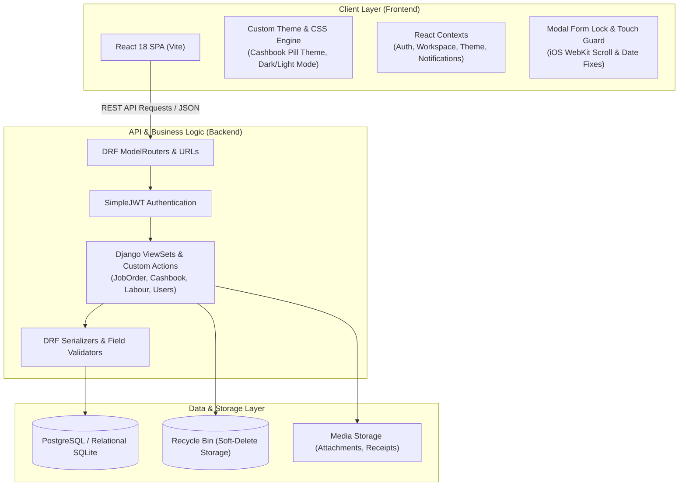
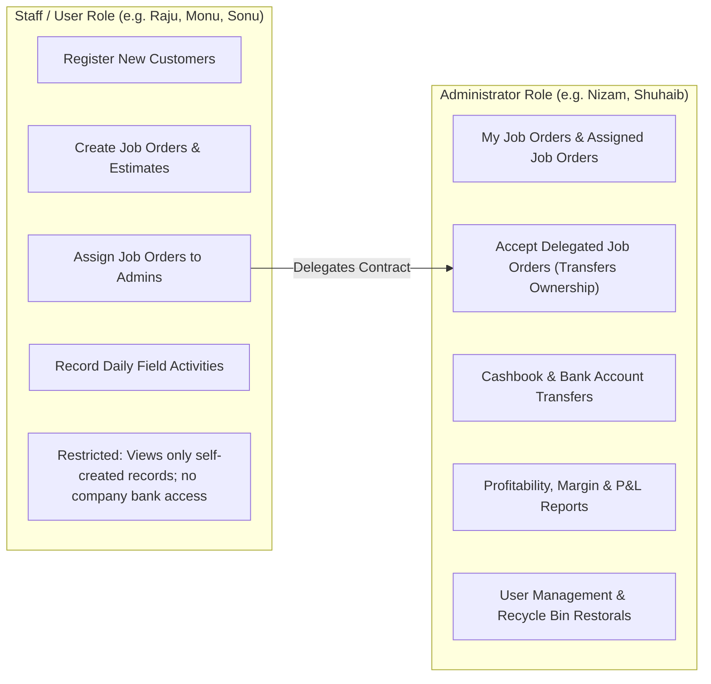
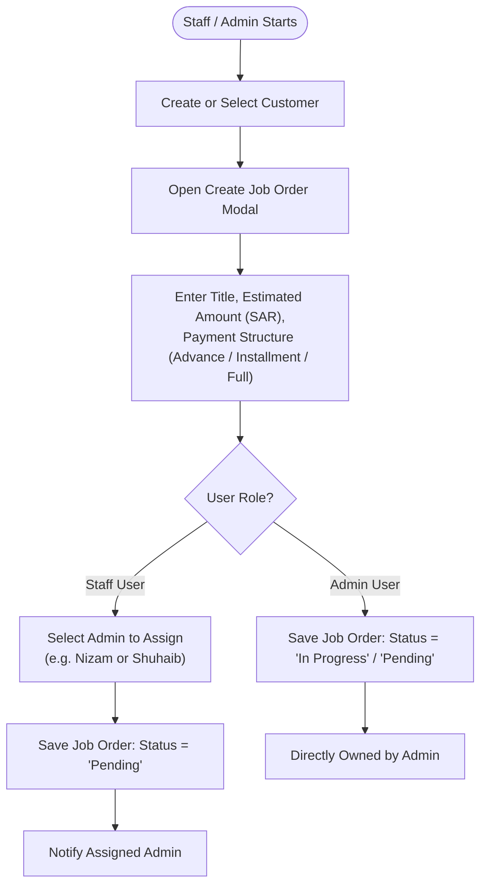
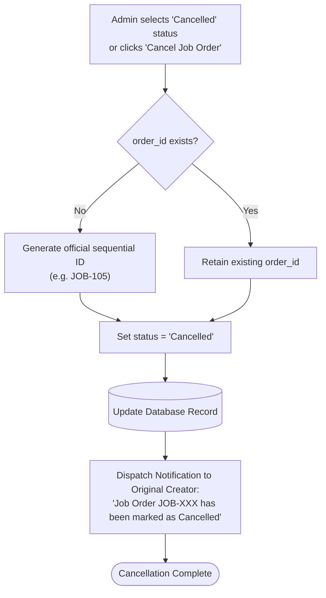
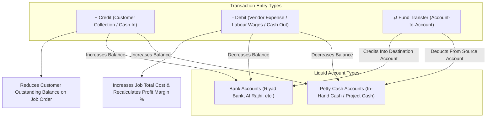
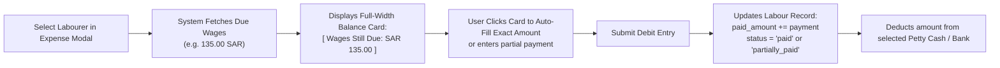
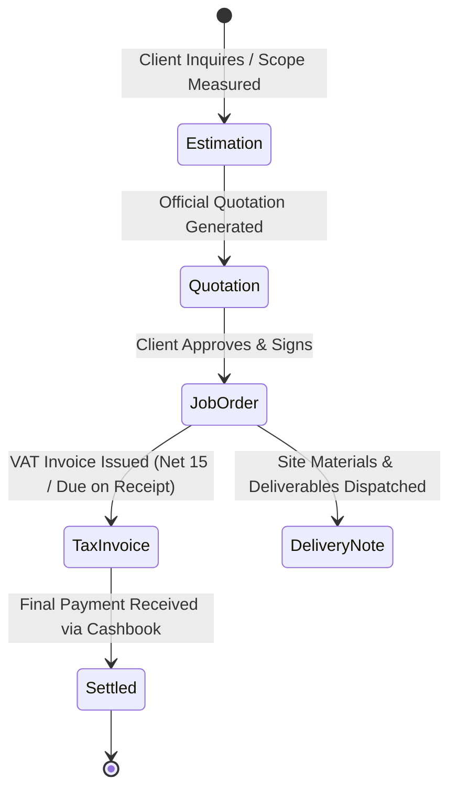
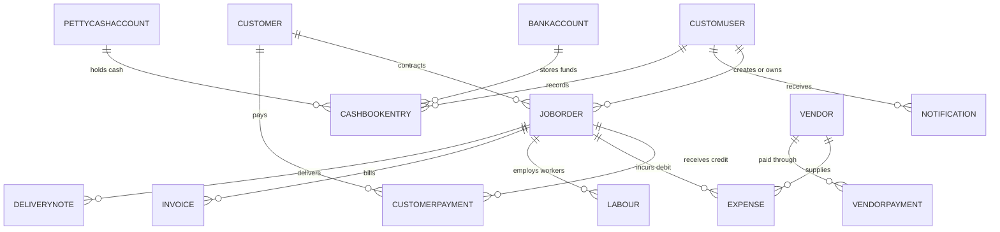

# Arab Season ERP — System Architecture & Workflow Flowchart Handbook
*A Comprehensive Behind-the-Scenes Technical & Operational Guide for All Users*

---

## 1. Executive Summary

**Arab Season ERP** is a centralized enterprise management system engineered specifically for Saudi Arabian contracting, estimation, field operations, and financial accounting. 

### Core Capabilities:
- **Project & Job Order Management**: Tracks client projects from initial cost estimation and formal quotations to job orders, ongoing expenses, milestone payments, and completion.
- **Role-Based Delegation (Staff → Admin)**: Allows field or project staff (e.g. Raju) to register clients and initiate contracts, then securely assign them to system administrators (e.g. Nizam or Shuhaib) who accept full operational and financial ownership.
- **Dual-Layer Accounting Engine (Cashbook & Banks)**: Real-time tracking of multi-bank accounts, multiple branch/personal petty cash holders, customer credits (+Income), vendor debits (-Expense), and direct account-to-account funds transfers.
- **Subcontractor & Labour Management**: Tracks daily wages, agreed project milestones, advance disbursements, and pending wage dues.
- **Accidental Closure Safeguards**: Enterprise form guards preventing loss of entered data on mobile and desktop devices.

---

## 2. Technology Stack & Architectural Overview

The system utilizes a decoupled client-server architecture designed for high availability, zero layout shifts, and responsive touch controls on iOS and Android.

### Technology Breakdown:
| Component | Technology | Role & Key Characteristics |
| :--- | :--- | :--- |
| **Frontend Framework** | React 18 (Vite 7) | High-speed SPA rendering with zero-delay page transitions |
| **Styling & Design** | Vanilla CSS + Tokens | Dark/Light mode tokens, HSL custom palette, Glassmorphism panels |
| **Backend API** | Django 4.x & DRF | Python 3.11 REST API engine with clean ModelViewSet architecture |
| **Authentication** | Django SimpleJWT | Stateless Bearer token auth with refresh token rotation |
| **Database** | PostgreSQL / SQLite | ACID-compliant relational storage with relational indexing |
| **Hosting Platform** | Linux cPanel / Passenger | Automated WSGI process manager with Nginx reverse proxy |

---

## 3. Role-Based Access Control (RBAC)

The system divides access into two primary operational tiers to safeguard company financials while enabling distributed data entry:

---

## 4. End-to-End Core Business Workflows

### Workflow 1: Customer Creation & Job Order Lifecycle

Every business operation begins by creating a Customer record, followed by initiating a Job Order.

---

### Workflow 2: Job Order Assignment (Staff → Admin Acceptance Transfer)

This workflow ensures that when field staff create a job, all subsequent accounting, payments, collections, and financial reports sit strictly under the responsible Admin's account.

```mermaid
sequenceDiagram
    autonumber
    actor Staff as Staff (Raju)
    participant System as Arab Season ERP Backend
    actor Admin as Admin (Nizam)

    Staff->>System: 1. Creates Job Order (JOB-101) & assigns to Nizam
    System->>System: 2. Marks assignment_status = 'pending', assigned_to = Nizam
    System-->>Admin: 3. Dispatches "New Job Order Assigned" Notification

    Note over Admin: Admin navigates to Job Orders<br/>Opens "Assigned Job Orders" tab<br/>Filters by Staff: [Raju]
    
    Admin->>System: 4. Clicks [ Accept Job Order ]
    
    rect rgb(20, 35, 20)
    Note over System: OWNERSHIP & LEDGER TRANSFER:<br/>- Sets created_by = Nizam (Admin)<br/>- Sets assignment_status = 'accepted'<br/>- Re-attributes all existing payments & expenses to Nizam<br/>- Disconnects Raju from active ownership
    end
    
    System-->>Admin: 5. Job Order moves to "My Job Orders" tab
    System-->>Staff: 6. Dispatches "Job Order Accepted" Notification
    Note over Staff: Raju can no longer alter<br/>or view this job order in active list
```

---

### Workflow 3: Job Order Cancellation Logic

If a contract is cancelled, the system guarantees audit compliance by preserving the reference number and alerting the creator.

---

### Workflow 4: Cashbook & Petty Cash Accounting Engine

The Cashbook handles all liquid capital flows, calculating real-time running balances and projected account totals.

#### Financial Formula Reference:
1. **Job Balance Still Due**:
   $$\text{Balance Still Due} = \text{Total Agreed Amount} - \text{Advance Paid} - \text{Customer Payments}$$
2. **Net Period Flow**:
   $$\text{Net Period Flow} = \text{Total Cash In (+Credit)} - \text{Total Cash Out (-Debit)}$$
3. **Projected Balance After Transfer**:
   $$\text{Projected Balance} = \text{Current Balance} \pm \text{Transfer Amount}$$

---

### Workflow 5: Subcontractor & Labour Wages Management

Labour expenses can be settled directly inside the `- Debit (Expense)` modal:

---

### Workflow 6: Document Engine (Estimates → Invoices → Delivery)

Contracts flow systematically from initial client inquiries to final delivery and tax invoices.

---

## 5. Database Entity-Relationship (ER) Architecture

The diagram below illustrates how core database models connect across the system:

---

## 6. UI/UX Safeguards & Mobile iOS Resilience

To prevent data loss and ensure seamless operation on mobile devices:

1. **Outside-Click Lock & Form Guard**:
   - Tapping or clicking outside a form window (on the overlay backdrop) **never closes the form**.
   - The form closes **only** via the explicit `X` or `Cancel` buttons.
   - If any data has been typed or modified, clicking `X` or `Cancel` opens an inline confirmation dialog:
     > **"Discard what you've entered?"**  
     > `[ Keep Editing ]` &nbsp;&nbsp; `[ Discard ]`
2. **iOS Safari WebKit Date Input Fix**:
   - Standard iOS Safari inputs enforce a wide minimum intrinsic width (~210px) that breaks multi-column layouts.
   - The ERP applies WebKit appearance overrides, preventing date pickers from colliding with receipt number inputs.
3. **Fixed-Position iOS Scroll Lock**:
   - On iOS mobile devices, opening a modal fixes `document.body` to the exact scroll offset (`position: fixed; top: -scrollY; width: 100%`).
   - Prevents touch-gesture scroll bleed into the background page while allowing smooth vertical scrolling inside the form.

---

## 7. Glossary & Reference Guide for Non-Technical Users

| Term | Plain English Explanation |
| :--- | :--- |
| **Job Order (Contract)** | An approved project agreement with a customer with a defined total price, milestone deliverables, and cost tracking. |
| **My Job Orders** | Contracts owned and managed directly under your account credentials. |
| **Assigned Job Orders** | Incoming contracts created by staff members that are awaiting an Administrator's review and formal acceptance. |
| **Acceptance Transfer** | The action where an Admin accepts a delegated job, permanently moving ownership and financial accounting under the Admin. |
| **+ Credit (Cash In)** | Money received into your bank account or petty cash (e.g. customer project payments or advances). |
| **- Debit (Cash Out)** | Money paid out from your bank or cashbox (e.g. vendor materials, fuel, daily labourer wages). |
| **Net Period Flow** | The net difference between all money received and all money spent over a specific date range. |
| **Petty Cash Account** | Physical cash in hand held by a specific branch or person (e.g. Suhail Petty Cash, Project Petty Cash). |
| **Projected Balance** | A live preview showing what an account's balance will become immediately after completing a payment or transfer. |
| **Recycle Bin** | A safety archive where deleted records are held, allowing them to be restored if deleted by accident. |
